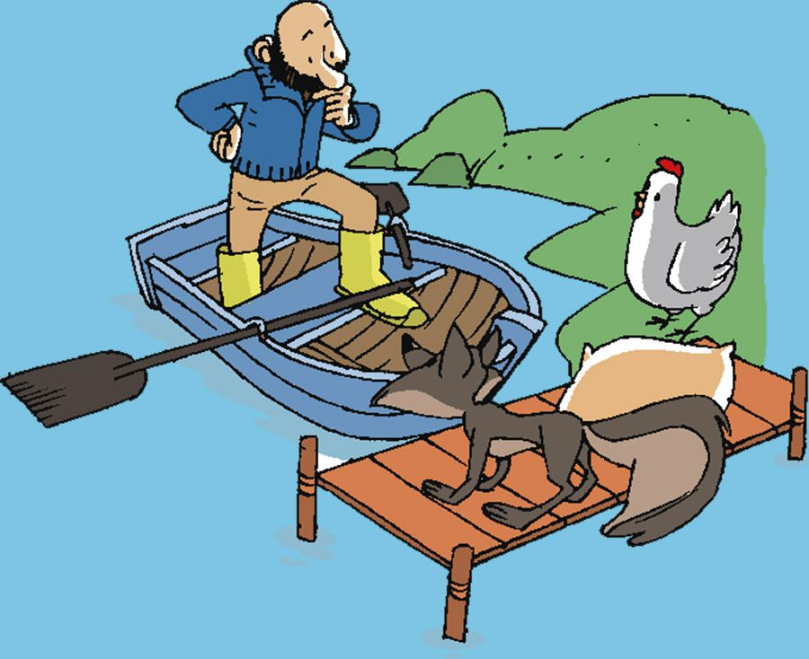
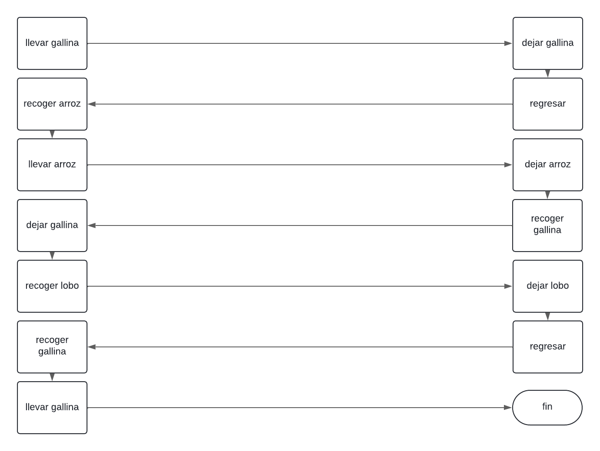
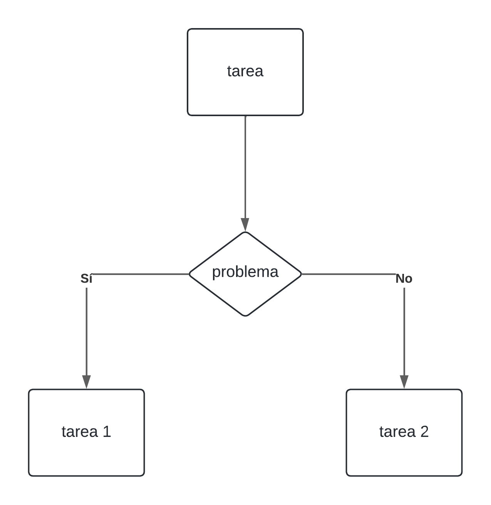

## Programaci&oacute;n de videojuegos
---
##### Introducci&oacute;n a la l&oacute;gica de la programaci&oacute;n 

--

### Puntos de la clase

  * Logica computacional

  * Resolucion de problem&aacute;ticas 

  * Introducci&oacute;n a los videojuegos

  * Uso de un Sistema MAC OS

---

## Que es la l&oacute;gica computacional?

### Veamos un ejemplo simple para entenderlo:

---

## El problema del lobo, el arroz y la gallina

--

### En este problema un hombre debe llevar 3 objetos al otro lado del r&iacute;o, un lobo, una gallina y un saco de arroz, pero solo puede llevar 1 a la vez, pero el lobo se comer&iacute;a a la gallina y la gallina al arroz, ¿como es posible?
---

## Valor de la respuesta: 10 puntos

---

 Un simple problema de organizaci&oacute;n que tiene un orden l&oacute;gico 

--

En diagrama de bloques (el sistema de organizacion de acciones que usan las maquinas) se representa de esta forma la operacion

---

 ### Toda m&aacute;quina cumple estos principios:

  * Esta hecha para seguir ciertos pasos en un orden logico
  
  * No pueden saltarse ning&uacute;n paso a menos que le sea indicado

  * En caso de no poder seguirlos sufrir&aacute; un error

---

## ¿Como resolver problem&aacute;ticas?
---

### Comencemos con una pregunta

Que haces en tu d&iacute;a a d&iacute;a?

---

### Durante tu d&iacute;a pueden ocurrir problemas, por ello es importante tener planes de respaldo
---
Las m&aacute;quinas presentan una forma similar de solucionar problemas, teniendo una respuesta para cada situaci&oacute;n 

--

### Esta es la forma en la que se representa la toma de decisiones en una m&aacute;quina 

---

### Entonces, como funcionan los videojuegos por detr&aacute;s de lo que se ve en pantalla?

--

### Todo juego tiene como base la toma de deciciones, justo como las m&aacute;quinas 
---
Esto es porque toda la inform&aacute;tica viene de las condicionales

--

* Novelas visuales
* Juegos de estrategia
* Shooter
* Mundo abierto

## Todos ellos tienen un c&oacute;digo detras que toma deciciones cada milisegundo

--

### Qui&eacute;n lea primero este texto tiene asegurados 15 puntos

---
## Como usar el Sistema de mac

--

#### Mac es al igual que windows un Sistema operativo, pero con ciertos cambios significativos, entre ellos:

  * Las aplicaciones no abren con ejecutables (.exe)

  * Para hacer cambios debes introducir la clave

  * Tiene muchas opciones de personalizaci&oacute;n 
---
### Debido a que es un Sistema operativo distinto, puede que las aplicaciones que existen en uno no esten presentes en el otro

