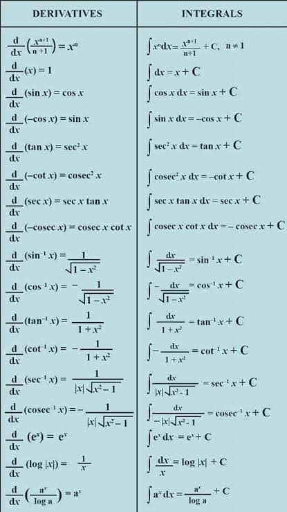

# C&aacute;lculo integral

An&aacute;lisis matem&aacute;tico

<small>Funciones reales de una sola variable</small>

---

## Agenda

- Particiones
- Sumas de Riemann
- Antiderivada e integral definida
- Teorema fundamental del c&aacute;lculo
- Teoremas del valor medio
- Consecuencias de los teoremas fundamentales
- Integrales indefinidas elementales

---

## Particiones (definici&oacute;n 1)

- Sea I un intervalo finito, una partici&oacute;n de I es un conjunto P finito tal que 
  * sus elementos son intervalos finitos contenidos en I
  * todo x &isin; I pertenece exactamente a uno de los intervalos en P.

---

## Particiones (definici&oacute;n 2)

- Sea I un intervalo finito `[a, b]`, una partici&oacute;n de I es un conjunto P finito tal que 
  * P = {<code>x0</code>, <code>x1</code>, ... , <code>xn</code>}
  * `a` = <code>x0</code> < <code>x1</code> < ... < <code>xn-1</code> < <code>xn</code> = `b`

---

## Longitud de un intervalo

- Sea I un intervalo finito, se denota como &#124; I &#124;
- Si `a`, `b` &isin; &real; `a < b`
  * &#124; `(a, b)` &#124; = `b - a`
  * &#124; `(a, b]` &#124; = `b - a`
  * &#124; `[a, b)` &#124; = `b - a`
  * &#124; `[a, b]` &#124; = `b - a`
- Si I es un punto &#124; I &#124; = `0`
- Si I = &empty; , &#124; I &#124; = `0`

---

## Aditividad de la longitud

- Si
  * I es un intervalo finito
  * `n` es un n&uacute;mero natural
  * P es una partici&oacute;n de I de cardinalidad `n`
- entonces
  * &#124; I &#124; = &Sigma;J &isin; P &#124; J &#124;

---

## Sumas de Riemann

- Sea
  * f: I &rarr; &real; una funci&oacute;n acotada en un intervalo finito
  * P una partici&oacute;n de I
- Se define como
  * Suma superior de Riemann   U(f, P) := &Sigma;J &isin; P:J &ne; &empty; (supx &isin; J f(x))&middot;&#124; J &#124;
  * Suma inferior de Riemann   L(f, P) := &Sigma;J &isin; P:J &ne; &empty; (infx &isin; J f(x))&middot;&#124; J &#124;

---

## Criterio de integrabilidad de Riemann

- Sea
  * I un intervalo finito
  * f : I &rarr; &real; una funci&oacute;n acotada en I
  * Sea &weierp;(I) el conjunto de todas las particiones posibles en I
- Se considera que f es integrable seg&uacute;n el criterio de Riemann si
  * infP &isin; &weierp;(I) U(f, P) = supP &isin; &weierp;(I) L(f, P)
- Este valor se define como la integral de Riemann de la funci&oacute;n f y se denota por
  * &int;I f(x) dx
  * si I es el intervalo cerrado [`a`, `b`], &int;ba f(x) dx

---

## Primer teorema valor medio (integrales)

- Sean
  * I = [`a`, `b`] un intervalo finito
  * f : [`a`, `b`] &rarr; &real; una funci&oacute;n integrable en [`a`, `b`] seg&uacute;n el criterio de Riemann
  * `M` = sup { f(x) : x &isin; [`a`, `b`] }
  * `m` = inf { f(x) : x &isin; [`a`, `b`] }
- ... entonces &exist;`c` &isin; &real; tal que:
  * `m` &le; `c` &le; `M`
  * &int;[a, b] f(x) dx = `c` (`b` - `a`)
- En particular, si f es continua en [`a`, `b`] entonces
  * &exist; x0 &isin; [`a`, `b`] : `c` = f(x0)

---

## Segundo teorema valor medio (integrales)

- Sean
  * I = [`a`, `b`] un intervalo finito
  * f : [`a`, `b`] &rarr; &real; una funci&oacute;n
    + integrable en [`a`, `b`] seg&uacute;n el criterio de Riemann
    + monot&oacute;nica creciente
- ... entonces &exist; x0 &isin; [`a`, `b`] tal que:
  * &int;[a, b] f(x) d&alpha;(x) = f(`a`) (x0 - a) + f(`b`) (b - x0)

---

## Segundo teorema valor medio (Riemann)

- Sean
  * I = [`a`, `b`] un intervalo finito
  * f : [`a`, `b`] &rarr; &real; una funci&oacute;n monot&oacute;nica creciente
  * g : [`a`, `b`] &rarr; &real; una funci&oacute;n continua
  * `A`, `B` &isin; &real; tales que
    + `A` &le; f(`a`+)
    + `B` &ge; f(`b`-)
- ... entonces &exist;x0 &isin; [`a`, `b`] tal que:
  * &int;[a, b] f(x) g(x) dx = `A` &int;[a, x0] g(x) dx + `B` &int;[x0, b] g(x) dx
- en particular, si &forall;x &isin; [`a`, `b`] f(x) &ge; `0` entonces
  * &int;[a, b] f(x) g(x) dx = `B` &int;[x0, b] g(x) dx

---

## Primer teorema fundamental del c&aacute;lculo

- Sean
  * `a`, `b` &isin; &real; : `a` < `b`
  * f : [`a`, `b`] &rarr; &real; una funci&oacute;n integrable seg&uacute;n el criterio de Riemann
  * F : [`a`, `b`] &rarr; &real; tal que F(x) := &int;[a, x] f
- entonces
  * F es continua en [`a`, `b`]
  * si x0 &isin; [`a`, `b`] y f es continua en x0, entonces F es diferenciable en x0 y F'(x0) = f(x0)

---

## Antiderivada

- Sea
  * I un intervalo finito
  * f : I &rarr; &real; una funci&oacute;n
- Se dice que la funci&oacute;n F : I &rarr; &real; es una antiderivada de f si
  * F es diferenciable en I
  * F'(x) = f(x) para todos los puntos l&iacute;mites x de I

---

## Ambig&uuml;edad de la antiderivada

- Sean
  * I un intervalo finito
  * f : I &rarr; &real; una funci&oacute;n
  * F : I &rarr; &real; y G : I &rarr; &real; dos antiderivadas de f
- ... entonces
  * &exist;C &isin; &real; : &forall;x &isin; I F(x) = G(x) + C

---

## Integrales indefinidas elementales

---

## Segundo teorema fundamental del c&aacute;lculo

- Sean
  * `a`, `b` &isin; &real; `a` &le; `b`
  * f : [`a`, `b`] &rarr; &real; una funci&oacute;n integrable seg&uacute;n el criterio de Riemann
  * F : [`a`, `b`] &rarr; &real; una antiderivada de f
- ... entonces
  * &int;[a, b]f = F(b) - F(a)

---

## Aditividad en intervalos contiguos

- Sean
  * [`a`, `c`] un intervalo finito
  * `b` &isin; &real; : `a` < `b` < `c`
  * f : [`a`, `c`] &rarr; &real; una funci&oacute;n integrable en [`a`, `c`] seg&uacute;n el criterio de Riemann
- ... entonces
  * &int;[a, b] f + &int;[b, c] f  = &int;[a, c] f

---

## Linearidad
Integraci&oacute;n por descomposici&oacute;n

- Sean
  * [`a`, `b`] un intervalo finito
  * `c` &isin; &real;
  * f : [`a`, `b`] &rarr; &real; y g : [`a`, `b`] &rarr; &real; dos funciones integrables en [`a`, `b`] seg&uacute;n el criterio de Riemann
- ... entonces
  * &int;[a, b] (f + g) = &int;[a, b] f + &int;[a, b] g
  * &int;[a, b] c f = c &int;[a, b] f

---

## Integraci&oacute;n por partes

- Sean
  * I = [`a`, `b`] un intervalo finito
  * F : I &rarr; &real; y G : I &rarr; &real; funciones
    +  derivables en I
    + integrables en I seg&uacute;n criterio de Riemann
- ... entonces
  * &int;[a, b] F G' = F(b) G(b) - F(a) G(a) - &int;[a, b] F' G
- ... o lo que es lo mismo
  * &int;[a, b] F G' = (F(x) G(x))&#124;ba - &int;[a, b] F' G

---

## Cambio de variable
Integraci&oacute;n por sustitu&oacute;n

- Sean
  * I = [`a`, `b`] un intervalo finito
  * &Phi; : [`a`, `b`] &rarr; [&Phi;(`a`), &Phi;(`b`)] una funci&oacute;n continua y mon&oacute;tona creciente
  * f : [&Phi;(`a`), &Phi;(`b`)] &rarr; &real; una funci&oacute;n integrable en [&Phi;(`a`), &Phi;(`b`)] seg&uacute;n el criterio de Riemann
- ... entonces
  * f &ordm; &Phi; : [`a`, `b`] &rarr; &real; es integrable seg&uacute;n criterio de Riemann en [`a`, `b`]
  * &int;[a, b] f &ordm; &Phi; d&Phi; = &int;[&Phi;(a), &Phi;(b)] f

---

## Cambio de variable (alt.)

- Sean
  * I = [`a`, `b`] un intervalo finito
  * &Phi; : [`a`, `b`] &rarr; [&Phi;(`a`), &Phi;(`b`)] una funci&oacute;n diferenciable y mon&oacute;tona creciente, tal que
    + &Phi;' es integrable seg&uacute;n criterio de Riemann
  * f : [&Phi;(`a`), &Phi;(`b`)] &rarr; &real; una funci&oacute;n integrable en [&Phi;(`a`), &Phi;(`b`)] seg&uacute;n el criterio de Riemann
- ... entonces
  * (f &ordm; &Phi;) &Phi;' : [`a`, `b`] &rarr; &real; es integrable en [`a`, `b`] seg&uacute;n criterio de Riemann 
  * &int;[a, b] (f &ordm; &Phi;) &Phi;' = &int;[&Phi;(a), &Phi;(b)] f

---

## Producto de funciones

- Sean
  * I = [`a`, `b`] un intervalo finito
  * f : [`a`, `b`] &rarr; &real; y g : [`a`, `b`] &rarr; &real; dos funciones integrables en [`a`, `b`] seg&uacute;n el criterio de Riemann
  * F : [`a`, `b`] &rarr; &real; : F(x) = &int;[a, x] f(t) dt
  * G : [`a`, `b`] &rarr; &real; : G(x) = &int;[a, x] g(t) dt
- ... entonces
  * &int;[a, b] f(x) g(x) dx = &int;[a, b] f(x) dG(x) = &int;[a, b] g(x) dF(x)

---

## Integraci&oacute;n de fracciones algebraicas

- Sean N(x) y D(x) dos polinomios se trata de calcular

<table>
  <tr>
    <td style="font-size: 250%; padding-left:0px; padding-right:0px">&int;</td>
    <td style="vertical-align: top; padding-left:0px; padding-right:0px">
      <table>
        <tr style="border-bottom: 1px solid white"><td>
N(x)
        </td></tr>
        <tr><td>
D(x)
        </td></tr>
      </table>
    </td>
    <td style="vertical-align: middle; padding-left:0px; padding-right:0px">dx</td>
  </tr>
</table>

- Para denominador de grado 2 se reduce a

<table>
  <tr>
    <td style="font-size: 250%; padding-left:0px; padding-right:0px">&int;</td>
    <td style="vertical-align: middle; padding-left:0px; padding-right:0px">Q(x) + </td>
    <td style="font-size: 250%; padding-left:0px; padding-right:0px">&int;</td>
    <td style="vertical-align: top; padding-left:0px; padding-right:0px">
      <table>
        <tr style="border-bottom: 1px solid white"><td>
`m` x + `n`
        </td></tr>
        <tr><td>
`a` x2 + `b` x + `c`
        </td></tr>
      </table>
    </td>
    <td style="vertical-align: middle; padding-left:0px; padding-right:0px">dx</td>
  </tr>
</table>
- ... donde
  * Q(x) es el polinomio cociente de la divisi&oacute;n
  * `a`, `b`, `c`, `m`, `n` &isin; &real;

---

## Integraci&oacute;n de fracciones algebraicas (cont.)

- Se puede reescribir como

<table>
  <tr>
    <td style="vertical-align: top; padding-left:0px; padding-right:0px">
      <table>
        <tr style="border-bottom: 1px solid white"><td>
1
        </td></tr>
        <tr><td>
`a`
        </td></tr>
      </table>
    </td>
    <td style="font-size: 250%; padding-left:0px; padding-right:0px">(</td>
    <td style="vertical-align: middle; padding-left:0px; padding-right:0px">`m` F(x) + `n` G(x)</td>
    <td style="font-size: 250%; padding-left:0px; padding-right:0px">)</td>
  </tr>
</table>

---

## Integraci&oacute;n de fracciones algebraicas (cont.)

- ... con F(x)

<table>
  <tr>
    <td style="vertical-align: top; padding-left:0px; padding-right:0px">
    <td style="font-size: 450%; padding-left:0px; padding-right:0px">&int;</td>
    <td style="vertical-align: top; padding-left:0px; padding-right:0px">
      <table>
        <tr style="border-bottom: 1px solid white">
          <td></td>
          <td></td>
          <td></td>
          <td style="align: center">
x
          </td>
          <td>dx</td>
        </tr>
        <tr>
          <td style="font-size: 250%; padding-left:0px; padding-right:0px">(</td>
          <td style="vertical-align: middle; padding-left:0px; padding-right:0px">
x +
          </td>
          <td style="vertical-align: top; padding-left:0px; padding-right:0px">
            <table>
              <tr style="border-bottom: 1px solid white"><td>
`b`
              </td></tr>
              <tr><td>
`2 a`
              </td></tr>
            </table>
          </td>
          <td style="font-size: 250%; padding-left:0px; padding-right:0px">
            )2</td>
          <td style="vertical-align: middle">
+
          </td>
          <td style="vertical-align: top; padding-left:0px; padding-right:0px">
            <table>
              <tr style="border-bottom: 1px solid white"><td>
`c`
              </td></tr>
              <tr><td>
`a`
              </td></tr>
            </table>
          </td>
          <td style="vertical-align: middle">
-
          </td>
          <td style="vertical-align: top; padding-left:0px; padding-right:0px">
            <table>
              <tr style="border-bottom: 1px solid white"><td>
`b`2</td>
              </td></tr>
              <tr><td>
`4 a`2</td>
              </td></tr>
            </table>
          </td>
        </tr>
      </table>
    </td>
  </tr>
</table>

- ... y G(x)

<table>
  <tr>
    <td style="vertical-align: top; padding-left:0px; padding-right:0px">
    <td style="font-size: 450%; padding-left:0px; padding-right:0px">&int;</td>
    <td style="vertical-align: top; padding-left:0px; padding-right:0px">
      <table>
        <tr style="border-bottom: 1px solid white">
          <td></td>
          <td></td>
          <td></td>
          <td>dx</td>
        </tr>
        <tr>
          <td style="font-size: 250%; padding-left:0px; padding-right:0px">(</td>
          <td style="vertical-align: middle; padding-left:0px; padding-right:0px">
x +
          </td>
          <td style="vertical-align: top; padding-left:0px; padding-right:0px">
            <table>
              <tr style="border-bottom: 1px solid white"><td>
`b`
              </td></tr>
              <tr><td>
`2 a`
              </td></tr>
            </table>
          </td>
          <td style="font-size: 250%; padding-left:0px; padding-right:0px">
            )2</td>
          <td style="vertical-align: middle">
+
          </td>
          <td style="vertical-align: top; padding-left:0px; padding-right:0px">
            <table>
              <tr style="border-bottom: 1px solid white"><td>
`c`
              </td></tr>
              <tr><td>
`a`
              </td></tr>
            </table>
          </td>
          <td style="vertical-align: middle">
-
          </td>
          <td style="vertical-align: top; padding-left:0px; padding-right:0px">
            <table>
              <tr style="border-bottom: 1px solid white"><td>
`b`2</td>
              </td></tr>
              <tr><td>
`4 a`2</td>
              </td></tr>
            </table>
          </td>
        </tr>
      </table>
    </td>
  </tr>
</table>

---

## Integrales &uacute;tiles

<table>
  <tr>
    <td style="font-size: 250%; padding-left:0px; padding-right:0px">&int;</td>
    <td style="vertical-align: top; padding-left:0px; padding-right:0px">
      <table>
        <tr style="border-bottom: 2px solid white">
          <td style="text-align: center">
dx
          </td>
        </tr>
        <tr><td>
x2
        </td></tr>
      </table>
    </td>
    <td style="vertical-align: middle; padding-left:0px; padding-right:0px">
      = -
    </td>
    <td style="vertical-align: top; padding-left:0px; padding-right:0px">
      <table>
        <tr style="border-bottom: 2px solid white">
          <td style="text-align: center">
`1`
          </td>
        </tr>
        <tr><td>
x
        </td></tr>
      </table>
    </td>
    <td style="vertical-align: middle; padding-left:0px; padding-right:0px">
+ C
    </td>
  </tr>
</table>

<table>
  <tr>
    <td style="font-size: 250%; padding-left:0px; padding-right:0px">&int;</td>
    <td style="vertical-align: top; padding-left:0px; padding-right:0px">
      <table>
        <tr style="border-bottom: 2px solid white">
          <td style="text-align: center">
x
          </td>
        </tr>
        <tr><td>
x2 &plusmn; `a`2
        </td></tr>
      </table>
    </td>
    <td style="vertical-align: middle; padding-left:0px; padding-right:0px">
      dx = &frac12; ln &#124; x2 &plusmn; `a`2 &#124; + C
    </td>
  </tr>
</table>

<table>
  <tr>
    <td style="font-size: 250%; padding-left:0px; padding-right:0px">&int;</td>
    <td style="vertical-align: top; padding-left:0px; padding-right:0px">
      <table>
        <tr style="border-bottom: 2px solid white">
          <td style="text-align: center">
dx
          </td>
        </tr>
        <tr><td>
x2 + `a`2
        </td></tr>
      </table>
    </td>
    <td style="vertical-align: middle">
      =
    </td>
    <td style="vertical-align: top; padding-right:0px">
      <table>
        <tr style="border-bottom: 2px solid white">
          <td style="text-align: center">
`1`
          </td>
        </tr>
        <tr><td>
`a`
        </td></tr>
      </table>
    </td>
    <td style="vertical-align: middle; padding-right:0px">
arctg
    </td>
    <td style="font-size:250%; padding-left:0px; padding-right:0px">
(
    </td>
    <td style="vertical-align: top; padding-left:0px; padding-right:0px">
      <table>
        <tr style="border-bottom: 2px solid white">
          <td style="text-align: center">
x
          </td>
        </tr>
        <tr><td>
`a`
        </td></tr>
      </table>
    </td>
    <td style="font-size:250%; padding-left:0px; padding-right:0px">
)
    </td>
    <td style="vertical-align: middle; padding-left:0px; padding-right:0px">
+ C
    </td>
  </tr>
</table>

<table>
  <tr>
    <td style="font-size: 250%; padding-left:0px; padding-right:0px">&int;</td>
    <td style="vertical-align: top; padding-left:0px; padding-right:0px">
      <table>
        <tr style="border-bottom: 2px solid white">
          <td style="text-align: center">
dx
          </td>
        </tr>
        <tr><td>
x2 - `a`2
        </td></tr>
      </table>
    </td>
    <td style="vertical-align: middle">
      =
    </td>
    <td style="vertical-align: top; padding-right:0px">
      <table>
        <tr style="border-bottom: 2px solid white">
          <td style="text-align: center">
`1`
          </td>
        </tr>
        <tr><td>
`2 a`
        </td></tr>
      </table>
    </td>
    <td style="vertical-align: middle; padding-right:0px">
ln
    </td>
    <td style="font-size:250%; padding-left:0px; padding-right:0px">
&#124;
    </td>
    <td style="vertical-align: top; padding-left:0px; padding-right:0px">
      <table>
        <tr style="border-bottom: 2px solid white">
          <td style="text-align: center">
x - `a`
          </td>
        </tr>
        <tr><td>
x + `a`
        </td></tr>
      </table>
    </td>
    <td style="font-size:250%; padding-left:0px; padding-right:0px">
&#124;
    </td>
    <td style="vertical-align: middle; padding-left:0px; padding-right:0px">
+ C
    </td>
  </tr>
</table>

---

## Integrales incalculables

- No pueden ser expresadas mediante un n&uacute;mero finito de operaciones que involucren funciones elementales
- Ejemplos

&int; e-x2 dx

<table>
  <tr>
    <td style="font-size: 250%; padding-left:0px; padding-right:0px">&int;</td>
    <td style="vertical-align: top; padding-left:0px; padding-right:0px">
      <table>
        <tr style="border-bottom: 1px solid white"><td>
sin x
        </td></tr>
        <tr><td style="text-align: center">
x
        </td></tr>
      </table>
    </td>
    <td style="vertical-align: middle; padding-left:0px; padding-right:0px">dx</td>
  </tr>
</table>

<table>
  <tr>
    <td style="font-size: 250%; padding-left:0px; padding-right:0px">&int;</td>
    <td style="vertical-align: top; padding-left:0px; padding-right:0px">
      <table>
        <tr style="border-bottom: 1px solid white"><td>
cos x
        </td></tr>
        <tr><td style="text-align: center">
x
        </td></tr>
      </table>
    </td>
    <td style="vertical-align: middle; padding-left:0px; padding-right:0px">dx</td>
  </tr>
</table>

<table>
  <tr>
    <td style="font-size: 250%; padding-left:0px; padding-right:0px">&int;</td>
    <td style="vertical-align: top; padding-left:0px; padding-right:0px">
      <table>
        <tr style="border-bottom: 1px solid white">
          <td style="text-align: center">
dx
        </td></tr>
        <tr><td style="text-align: center">
ln &#124; x &#124;
        </td></tr>
      </table>
    </td>
  </tr>
</table>

