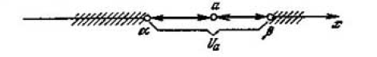
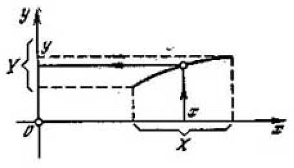
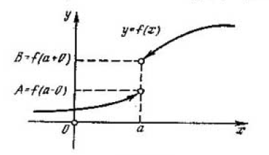
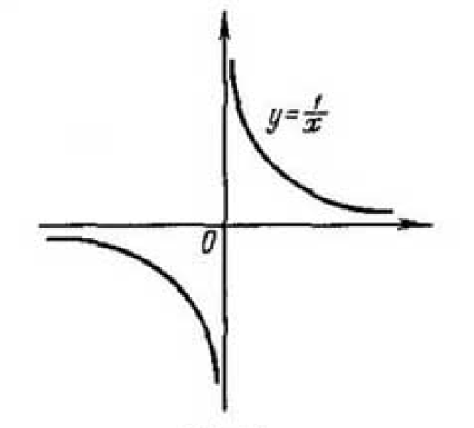
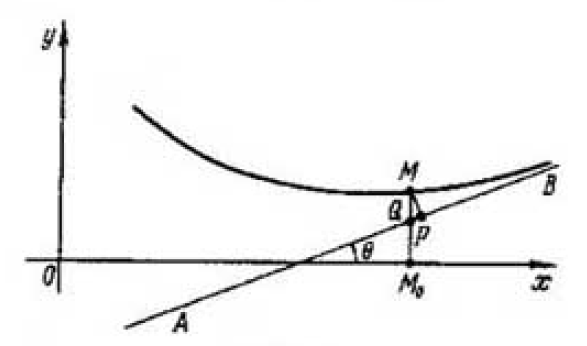

# L&iacute;mite y continuidad

An&aacute;lisis matem&aacute;tico

<small>Funciones reales de una sola variable</small>

---

## Agenda

- Funciones num&eacute;ricas
- Sucesiones
- L&iacute;mite de una sucesi&oacute;n
- L&iacute;mite de una funci&oacute;n
- Funciones infinitamente peque&ntilde;as y grandes
- Continuidad de una funci&oacute;n
  * Continuidad uniforme
- Comparaci&oacute;n de funciones
- As&iacute;ntotas

---

## Magnitudes

- Constantes
  * conserva un mismo valor
    + en general
    + en un proceso dado (par&aacute;metro)
- Variable
  * toma valores num&eacute;ricos diferentes

---

## Funci&oacute;n

- `y` = f(`x`)
- Una variable `y` es funci&oacute;n de otra variable `x` si
  * est&aacute;n relacionadas
    + relaci&oacute;n funcional
  * a cada valor de `x` le corresponde un valor de `y`
    + &uacute;nico
    + totalmente determinado
- `x` : argumento o variable independiente
- `y` : variable dependiente

---

## Conjuntos

- Dominio de definici&oacute;n (dominio de existencia)
  * Conjunto de todos los valores de la variable independiente para los cuales la funci&oacute;n est&aacute; definida
- 

---

## Conjuntos (cont.)

- Entorno del punto `a` &isin; &real;
  * Intervalo (&alpha;, &beta;) tal que
    + &alpha; &le; `a` &le; &beta;
    + se excluye el punto `a`
- Entorno izquierdo del punto `a` &isin; &real;
  * Intervalo (&alpha;, `a`)
- Entorno derecho del punto `a` &isin; &real;
  * Intervalo (`a`, &beta;)

---

## L&iacute;mite de una funci&oacute;n

- limx &rarr; a f(x) = `A`
  * &forall;&epsilon;&gt;`0` &exist;&delta;(&epsilon;)
    + `0` &lt; &#124; x - `a` &#124; &lt; &delta;(&epsilon;) implies &#124; f(x) - `A` &#124; &lt; &epsilon;

---

## L&iacute;mite unilateral

- limx &rarr; a- f(x) = `A`
  * &forall;&epsilon; &gt;`0` &exist;&delta;(&epsilon;)
    + x &isin; (&delta;(&epsilon;)`, a`) implies &#124; f(x) - `A` &#124; &lt; &epsilon;
- limx &rarr; a+ f(x) = `B`
  * &forall;&epsilon; &gt;`0` &exist;&delta;(&epsilon;)
    + x &isin; (`a`, &delta;(&epsilon;)) implies &#124; f(x) - `B` &#124; &lt; &epsilon;

---

## L&iacute;mite vs infinito

- limx &rarr; +&infin; f(x) = `A`
  * &forall;&epsilon; &gt;`0` &exist;&delta;(&epsilon;) &gt; `0`
    + &forall;x &gt; &delta;(&epsilon;) : &#124; f(x) - `A` &#124; &lt; &epsilon;
- limx &rarr; -&infin; f(x) = `B`
  * &forall;&epsilon; &gt;`0` &exist;&delta;(&epsilon;) &lt; `0`
    + &forall; x &lt; &delta;(&epsilon;) : &#124; f(x) - `B` &#124; &lt; &epsilon;
- limx &rarr; a f(x) = -&infin;
  * Cambia a f(x) &lt; -&epsilon;
- limx &rarr; a f(x) = +&infin;
  * Cambia a f(x) &gt; &epsilon;

---

## Sucesi&oacute;n

- Funci&oacute;n en el dominio de los n&uacute;meros naturales
- x1, x2, ..., xn, ... 

---

## L&iacute;mite de una sucesi&oacute;n

- limn &rarr; &infin; xn = `A`
  * &forall;&epsilon; &gt;`0` &exist;N(&epsilon;)
    + &forall; n &gt; N(&epsilon;) : &#124; xn - `B` &#124; &lt; &epsilon;

---

## L&iacute;mite de una funci&oacute;n constante

- Sean
   * `c` &isin; &real;
   * f(x) = `c`
- ... entonces
   * limx &rarr; a f(x) = `c`

---

## L&iacute;mite vs cotas de la funci&oacute;n

- Sea
  * limx &rarr; a f(x) = `A`
  * &exist;&epsilon;, `M`, `N` &isin; &real : &forall;x &isin; (`a` - &epsilon;, `a` + &epsilon;) `M` &lt; f(x) &lt; `N`
- ... entoncces
  * `M` &le; `A` &le; `N`

---

## Conservaci&oacute;n del signo

- Sean
  * `a`, `c`, x0 &isin; &real; : `c` &gt; `0`
  * f: &real; &rarr; &real; una funci&oacute;n
  * limx &rarr; x0 f(x) = `a`
- ... entonces &exist;c, &epsilon; &gt; `0`
  * si `a` &gt; 0 , &forall;x &isin; &#124; x - x0 &#124; f(x) &gt; `c`
  * si `a` &lt; 0 , &forall;x &isin; &#124; x - x0 &#124; f(x) &lt; `c`

---

## Convergencia

- Sean
  * &phi;(x) &le; f(x) &le; &psi;(x)
  * limx &rarr; x0 &phi;(x) = limx &rarr; x0 &psi;(x) = `a`
    + `a` puede ser -&infin; o +&infin;
- ... entonces
  * limx &rarr; x0 f(x) = `a`

---

## Linearidad

- Sean
  * f(x), g(x)
  * Existen
    + limx &rarr; x0 f(x)
    + limx &rarr; x0 g(x)
- ... entonces
  * limx &rarr; x0 f(x) + g(x) = limx &rarr; x0 f(x) + limx &rarr; x0 g(x)
  * limx &rarr; x0 f(x) &middot; g(x) = limx &rarr; x0 f(x) &middot; limx &rarr; x0 g(x)
  * si limx &rarr; x0 g(x) &ne; `0`

<table>
  <tr>
    <td style="vertical-align:middle; padding-left:0px; padding-right:0px">
      limx &rarr; x0
    </td>
    <td style="vertical-align: top; padding-left:0px; padding-right:0px">
      <table>
        <tr style="border-bottom: 1px solid white"><td>
f(x)
        </td></tr>
        <tr><td>
g(x)
        </td></tr>
      </table>
    </td>
    <td style="vertical-align: middle">=</td>
    <td style="vertical-align: top; padding-left:0px; padding-right:0px">
      <table>
        <tr style="border-bottom: 1px solid white"><td>
limx &rarr; x0 f(x)
        </td></tr>
        <tr><td>
limx &rarr; x0 g(x)
        </td></tr>
      </table>
    </td>
  </tr>
</table>

---

## L&iacute;mite de la composici&oacute;n de funciones

- Sean
  * x0, y0 &isin; &real;
  * f, g : &real; &rarr; &real; funciones tales que
    + limx &rarr; x0 f(x) = y0
    + existe limy &rarr; y0 g(y)
- ... entonces
  * limx &rarr; x0 g( f(x) ) = limy &rarr; y0 g(y)

---

## Criterio de existencia Cauchy

- Sean
  * f: &real; &rarr; &real;
- es equivalente
  * f tiene l&iacute;mite finito en x &rarr; x0
  * &forall;&epsilon; &gt; `0` &exist;&delta; tal que
    + &forall;x', x'' &isin; (x0 - &delta;, x0 + &delta;) &#124; f(x'') - f(x') &#124; &lt; &epsilon;

---

## Funciones infinitamente peque&ntilde;as y grandes

- &alpha; : &real; &rarr; &real; es inifinitamente peque&ntilde;a para x &rarr; x0
  * limx &rarr; x0 &alpha;(x) = `0`
  * infinitesimal
- &alpha; : &real; &rarr; &real; es inifinitamente grande para x &rarr; x0
  * limx &rarr; x0 &alpha;(x) = &infin;
  * infinita

---

## L&iacute;mite vs infinitesimal

- Son equivalentes
  * limx &rarr; x0 f(x) existe y es igual a `a`
  * f(x) = `a` + &alpha;(x) tal que
    - &alpha;(x) es infinitesimal para x &rarr; x0

---

## Propiedades de los infinitesimales

- Sean
  * &alpha;(x) y &beta;(x) son infinitesimales en x &rarr; x0
- ... entonces tambien son infinitesimales
  * &alpha;(x) + &beta;(x)
  * &alpha;(x) &middot; &beta;(x)

---

## Infinitesimales vs infinito

- Sea
  * f(x) una funci&oacute;n infinitamente grande en x &rarr; x0
- ... entonces es infinitesimal la funci&oacute;n

<table>
  <tr style="border-bottom: 2px solid white">
    <td style="text-align:center;">
1
    </td></tr>
    <tr><td>
f(x)
    </td>
  </tr>
</table>

<table>
  <tr>
    <td style="vertical-align: top; padding-left:0px; padding-right:0px">
      <table>
        <tr style="border-bottom: 2px solid white"><td>
`a`
        </td></tr>
        <tr><td>
`+0`
        </td></tr>
      </table>
    </td>
    <td style="vertical-align:middle; padding-left:0px">
      = +&infin;;
    </td>
    <td style="vertical-align: top; padding-left:0px; padding-right:0px">
      <table>
        <tr style="border-bottom: 2px solid white"><td>
`a`
        </td></tr>
        <tr><td>
`-0`
        </td></tr>
      </table>
    </td>
    <td style="vertical-align: middle"> = -&infin;;</td>
    </td>
    <td style="vertical-align: top; padding-left:0px; padding-right:0px">
      <table>
        <tr style="border-bottom: 2px solid white"><td>
`a`
        </td></tr>
        <tr><td>
`0`
        </td></tr>
      </table>
    </td>
    <td style="vertical-align: middle"> = &infin;</td>
  </tr>
</table>

<table>
  <tr>
    <td style="vertical-align: top; padding-left:0px; padding-right:0px">
      <table>
        <tr style="border-bottom: 2px solid white"><td>
`a`
        </td></tr>
        <tr><td>
      +&infin;
        </td></tr>
      </table>
    </td>
    <td style="vertical-align:middle; padding-left:0px">
= `+0`;
    </td>
    <td style="vertical-align: top; padding-left:0px; padding-right:0px">
      <table>
        <tr style="border-bottom: 2px solid white"><td>
`a`
        </td></tr>
        <tr><td>
-&infin;
        </td></tr>
      </table>
    </td>
    <td style="vertical-align: middle">
= `-0`;
    </td>
    <td style="vertical-align: top; padding-left:0px; padding-right:0px">
      <table>
        <tr style="border-bottom: 2px solid white"><td>
`a`
        </td></tr>
        <tr><td>
&infin;
        </td></tr>
      </table>
    </td>
    <td style="vertical-align: middle"> = `0`</td>
  </tr>
</table>

---

## L&iacute;mites notables

<table>
  <tr>
    <td style="vertical-align:middle; padding-left:0px">
      limx &rarr; 0
    </td>
    <td style="vertical-align: top; padding-left:0px">
      <table>
        <tr style="border-bottom: 2px solid white">
          <td style="text-align:center">
sin x
          </td>
        </tr>
        <tr>
          <td style="text-align:center">
x
          </td>
        </tr>
      </table>
    </td>
    <td style="vertical-align:middle; padding-left:0px">
      = `1`
    </td>
  </tr>
</table>

<table>
  <tr>
    <td style="vertical-align:middle; padding-left:0px">
      limx &rarr; 0 (1 + x)
      1 / x
    </td>
    <td style="vertical-align:middle; padding-left:0px">
      = `e`
    </td>
  </tr>
</table>

---

## Continuidad de una funci&oacute;n

- Incremento infinitamente peque&ntilde;o del argumento
- Incremento infinitamente peque&ntilde;o de la funci&oacute;n
- limx - x0 &rarr; 0 (f(x) - f(x0)) = `0`
- lim&Delta;x &rarr; 0 &Delta;y = `0`

---

## Continuidad uniforme

---

## Propiedades de funciones continuas

- Son acotadas (Weierstrass)
- &forall;C : f(`a`) &lt; C &lt; f(`b`)
  * &exist; &xi; &isin; (`a`, `b`) : f(&xi;) = C

---

## Punto de discontinuidad

- Sea
  * x0 &isin; &real;
  * f(x) definida en un entorno de x0
    + excepto, posiblemente, en el propio punto
- f no est&aacute; definida en x0
- f no es continua en x0

---

## Discontinuidad de primer g&eacute;nero

- f(x0-) = limx &rarr; x0- f(x)
- f(x0+) = limx &rarr; x0+ f(x)
- Salto de la funci&oacute;n f en el punto x0
  * f(x0+) - f(x0-)
  * ... cuando es `0` , discontinuidad evitable 

---

## Discontinuidad de segundo g&eacute;nero

---

## Comparaci&oacute;n de funciones

- Sean
  * f, g : &real; &rarr; &real;
  * x0 &isin; &real;
- ... si existe
  * `c` &isin; &real;
  * un entorno U(x0) del punto x0 tal que
    + &forall;x &isin; U(x0) : &#124; f(x) &#124; &le; `c` &middot; &#124; g(x) &#124;
- ... entonces f es acotada en comparaci&oacute;n con la funci&oacute;n g en el entorno de x0
  * f(x) = O(g(x)) , x &rarr; x0

---

## Funciones del mismo grado

- f = O(g)
- g = O(f)

<table>
  <tr>
    <td style="vertical-align:middle; padding-left:0px; padding-right:0px">
      limx &rarr; x0
    </td>
    <td style="vertical-align: top; padding-left:0px; padding-right:0px">
      <table>
        <tr style="border-bottom: 2px solid white"><td>
f(x)
        </td></tr>
        <tr><td>
g(x)
        </td></tr>
      </table>
    </td>
    <td style="vertical-align: middle">= `k` &ne; `0`</td>
  </tr>
</table>

- `k` = `1` : equivalentes

---

## Notaci&oacute;n **o**

- Sean
  * f, &alpha; : &real; &rarr; &real;
  * x0 &isin; &real;
- ... si existe
  * &epsilon; : &real; &rarr; &real; infinitesimal para x &rarr; x0
  * un entorno U(x0) del punto x0 tal que
    + &forall;x &isin; U(x0) : &alpha;(x) = &epsilon;(x) &middot; f(x)
- ... entonces &alpha; es infinitesimal en comparaci&oacute;n con la funci&oacute;n f en el entorno de x0
  * f(x) = o(g(x)) , x &rarr; x0

---

## As&iacute;ntotas

- Recta y = `k` x + `l` tal que
  * f(x) - `k` x - `l` = o(`1`)
- f(x) se comporta como una recta
  * x &rarr; +&infin; o x &rarr; -&infin;

---

## Relaci&oacute;n con l&iacute;mites

<table>
  <tr>
    <td style="vertical-align:middle; padding-left:0px; padding-right:0px">
      `k` = limx &rarr; &infin;
    </td>
    <td style="vertical-align: top; padding-left:0px; padding-right:0px">
      <table>
        <tr style="border-bottom: 2px solid white"><td>
f(x)
        </td></tr>
        <tr>
          <td style="text-align: center">
x
          </td>
        </tr>
      </table>
    </td>
  </tr>
</table>

`l` = limx &rarr; &infin; (f(x) - `k` x)

