# Movimiento rotacional

 F&iacute;sica &dash; Mec&aacute;nica

---

## Agenda

- Movimiento rotacional. Definici&oacute;n
- Cinem&aacute;tica de la rotaci&oacute;n
  * Variables de la rotaci&oacute;n. Naturaleza vectorial
  * Rotaci&oacute;n con aceleraci&oacute;n angular constante
  * Relaci&oacute;n entre las variables de traslaci&oacute;n y rotaci&oacute;n
- Din&aacute;mica de la rotaci&oacute;n
  * Torque. Inercia rotacional
  * Movimiento compuesto
- Momento angular
  * Conservaci&oacute;n del momento angular

---

## Movimiento compuesto

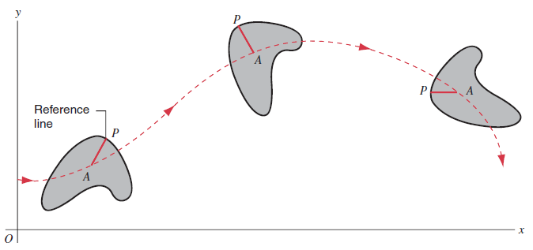

- Se puede descomponer en
  * traslaci&oacute;n de un punto fijo del cuerpo
  * rotaci&oacute;n de una l&iacute;nea de referencia
    + entre dos puntos fijos del cuerpo

---

## Rotaci&oacute;n pura

- Todos los puntos de un cuerpo se mueven en trayectorias circulares
- Los centros de estas circunferencias tienen que estar ubicados en una l&iacute;nea recta
  * eje de rotaci&oacute;n
- Todas las trayectorias perpendiculares al eje de rotaci&oacute;n
  * mismo &aacute;ngulo en los mismos intervalos de tiempo

--

## Rueda

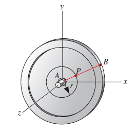

---

## Posici&oacute;n angular

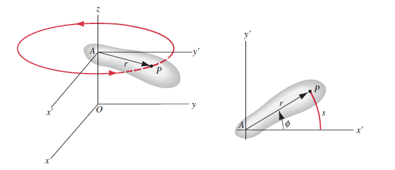

- sentido positivo contrario al reloj
- &Phi; = s / r

---

## Desplazamiento angular

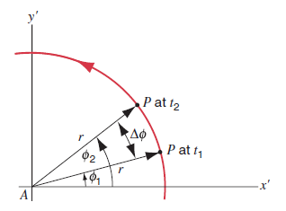

- Velocidad angular
  * &omega; = lim&Delta;t &rarr; 0 &Delta;&Phi; / &Delta;t = d&Phi;/dt
- Aceleraci&oacute;n angular
  * &alpha; = lim&Delta;t &rarr; 0 &Delta;&omega; / &Delta;t = d&omega;/dt

--

## Aplicaciones sucesivas

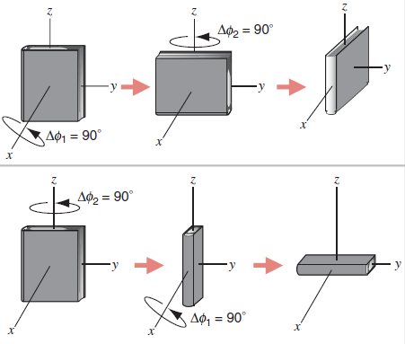

- Desplazamiento angular &Delta;&Phi; no es un vector

--

## Desplazamiento angular infinitesimal

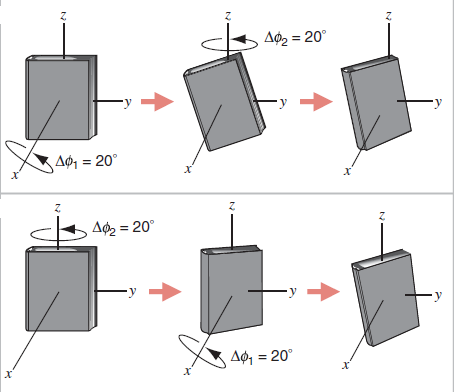

- Desplazamiento angular d&Phi; s&iacute; es un vector

---

## Velocidad angular (vector)

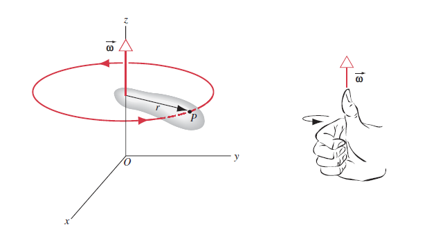

- Regla de la mano derecha

---

## Magnitudes angulares vs lineales

Rotaci&oacute;n pura. Cuerpo r&iacute;gido

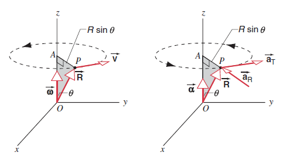

- **v** = **&omega;** &times; **R**
- **a** = **aT** + **aR**
- **aT** = **&alpha;** &times; **R**
- **aR** = **&omega;** &times; **v**

---

## Comprendiendo el torque

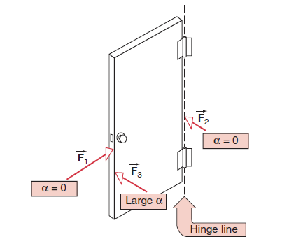

- Aceleraci&oacute;n var&iacute;a seg&uacute;n
  * direcci&oacute;n de la fuerza
  * distancia desde el eje de rotaci&oacute;n

---

## Torque

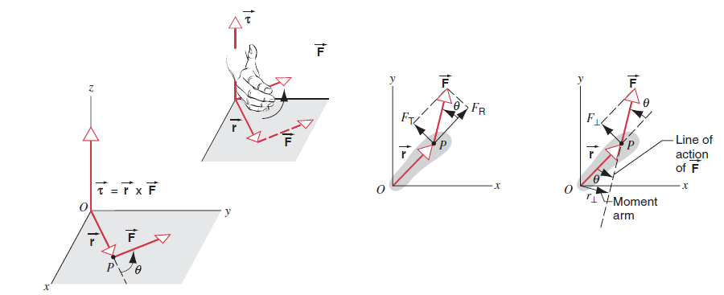

- Direcci&oacute;n fija del eje de rotac&oacute;n
  * **&tau;** = **r** &times; **F**
- L&iacute;nea de acci&oacute;n
- Brazo de la fuerza

--

## Torque (ejemplo)

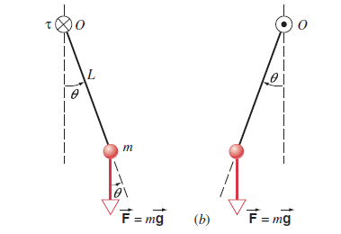

- Fuerza de gravedad
- Se desprecia la masa de la cuerda
- El torque cambia de sentido mientras oscila

---

## Inercia rotacional (part&iacute;cula)

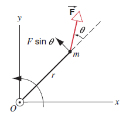

- &tau;z = I &alpha;z
- I = m r2
  * Inercia rotacional
- Se deduce de la segunda ley de Newton

---

## Inercia rotacional (sistema de part&iacute;culas)

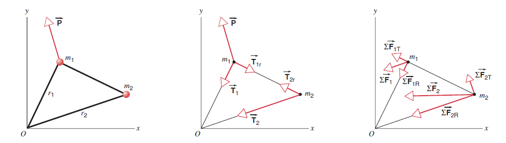

- &Sigma; &tau;z = I &alpha;z
- I = &Sigma; mi ri2
  * Inercia rotacional

---

## Teorema de Huygens-Steiner

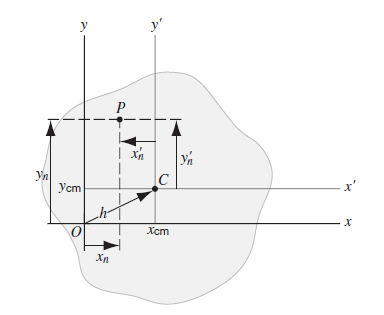

- I = Icm + Mh2
- I : con respecto a cualquier eje
- Icm : alrededor de un eje
  * paralelo
  * que pasa por el centro de masas

---

## Inercia rotacional de un s&oacute;lido r&iacute;gido

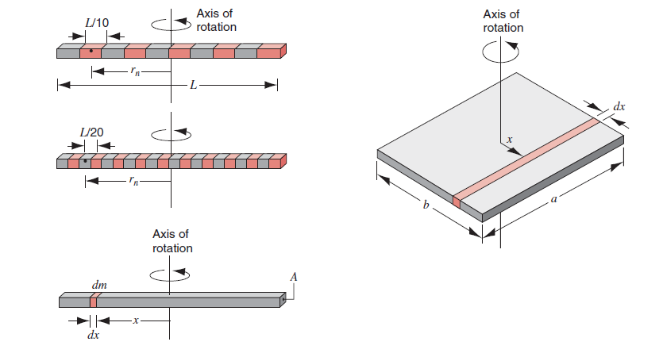

- I = &int; r2 dm

--

## Inercia rotacional (ejemplos)

Aro girando sobre su eje

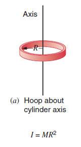

--

## Inercia rotacional (ejemplos)

Cilindro hueco o anillo girando sobre su eje

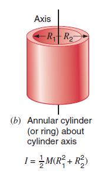

--

## Inercia rotacional (ejemplos)

Cilindro s&oacute;lido girando sobre su eje

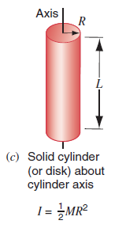

--

## Inercia rotacional (ejemplos)

Cilindro s&oacute;lido girando sobre su di&aacute;metro central

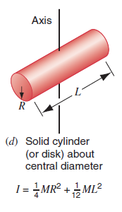

--

## Inercia rotacional (ejemplos)

Barra fina girando sobre su di&aacute;metro central

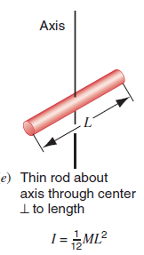

--

## Inercia rotacional (ejemplos)

Barra fina girando sobre un extremo

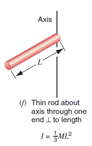

--

## Inercia rotacional (ejemplos)

Esfera girando sobre un di&aacute;metro

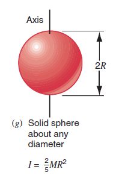

--

## Inercia rotacional (ejemplos)

Esfera hueca o globo girando sobre un di&aacute;metro

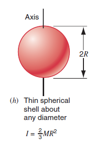

--

## Inercia rotacional (ejemplos)

Aro girando sobre un di&aacute;metro

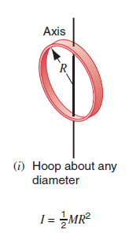

--

## Inercia rotacional (ejemplos)

L&aacute;mina rect&aacute;ngular fina girando sobre su centro

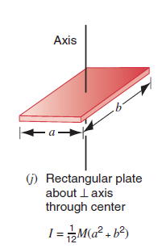

---

## Movimiento compuesto (simple)

- Sistema de referencia inercial
- Hip&oacute;tesis sobre el eje de rotaci&oacute;n
  * pasa por el centro de masas
  * siempre mantiene la misma direcci&oacute;n
- Se descompone en dos movimientos independientes
  * Traslaci&oacute;n del centro de masas
  * Rotaci&oacute;n alrededor del eje

--

## An&aacute;lisis de un punto en una rueda

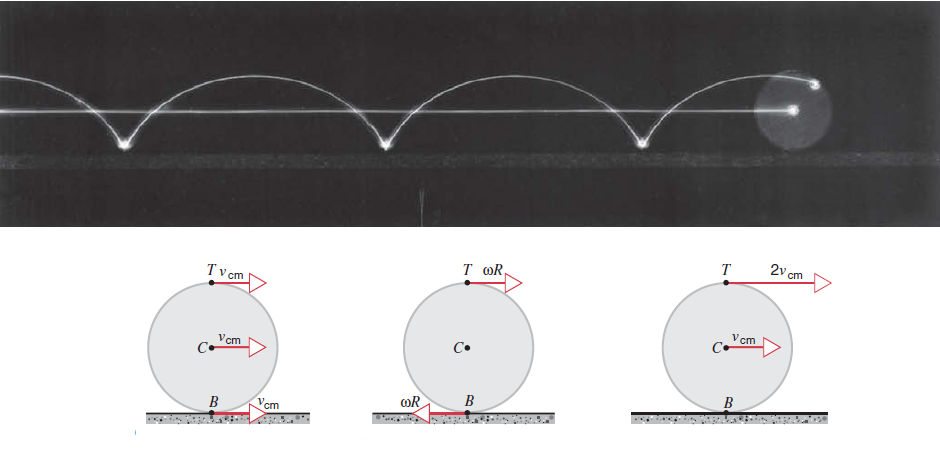

--

## Instant&aacute;nea de la rotaci&oacute;n

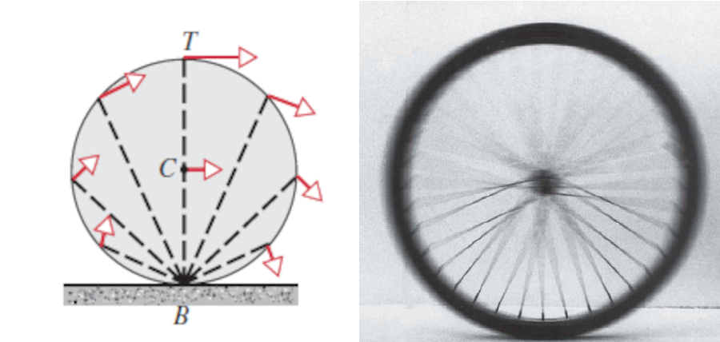

- Rotaci&oacute;n alrededor de un eje instant&aacute;neo
  * ... en el punto de contacto

---

## Momento angular

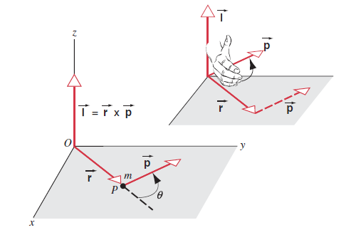

- **l** = **r** &times; **p**
- **p** = m **v**

<table>
  <tr>
    <td style="vertical-align:middle;font-size: 150%; padding-left:0px; padding-right:0px">&Sigma;</td>
    <td style="vertical-align:middle; padding-left:0px; padding-right:0px">
      **&tau;** =
    </td>
    <td style="vertical-align: top; padding-left:0px; padding-right:0px">
      <table>
        <tr style="border-bottom: 1px solid white"><td>
d**l**
        </td></tr>
        <tr><td>
dt
        </td></tr>
      </table>
    </td>
  </tr>
</table>

---

## Momento angular (sistema de part&iacute;culas)

- **ln** = **r**n &times; **pn**
- **L** = &Sigma; **ln**

<table>
  <tr>
    <td style="vertical-align:middle;font-size: 150%; padding-left:0px; padding-right:0px">&Sigma;</td>
    <td style="vertical-align:middle; padding-left:0px; padding-right:0px">
      **&tau;** =
    </td>
    <td style="vertical-align: top; padding-left:0px; padding-right:0px">
      <table>
        <tr style="border-bottom: 1px solid white"><td>
d**L**
        </td></tr>
        <tr><td>
dt
        </td></tr>
      </table>
    </td>
  </tr>
</table>

---

## Coordenadas en el centro de masas

- **L** = **R** &times; **P** + &Sigma;i **ri** &times; **pi**
  * Respecto al sistema de coordenadas global
    + **L** : momento angular total del sistema de part&iacute;culas
    + **R** : posici&oacute;n del centro de masas respecto al sistema original
    + **P** : cantidad de movimiento de toda la masa concentrada en el centro de masas
  * Respecto al centro de masas
    + **ri** : posici&oacute;n de cada part&iacute;cula
    + **pi** : cantidad de movimiento de cada part&iacute;cula

---

## Influencia del torque en la rotaci&oacute;n

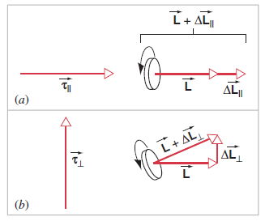

- Variaci&oacute;n de la magnitud del momento angular
- Cambio de direcci&oacute;n del eje de rotaci&oacute;n

---

## Rotaci&oacute;n de una part&iacute;cula

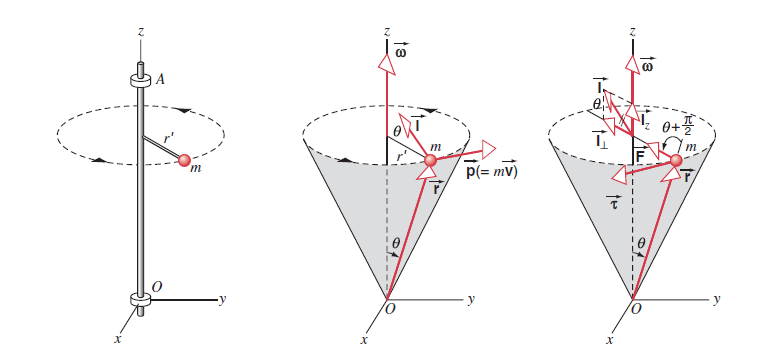

- Momento vs velocidad angular
  * no son paralelos
- Diferencia con el movimiento de desplazamiento
  * **v** siempre es paralelo a **p**

---

## Rotaci&oacute;n de dos part&iacute;culas

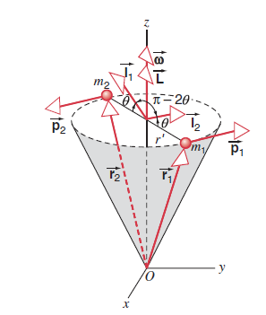

- Simetr&iacute;a de masas alrededor del eje 
- Momento y velocidad angular paralelos 
  * **L** = I **&omega;**
- Extensible a s&oacute;lido r&iacute;gido

---

## Conservaci&oacute;n del momento angular

- Hip&oacute;tesis
  * Toque externo neto sobre un sistema es nulo
- ... entonces
  * El momento angular se mantiene constante
- V&aacute;lido para cualquier componente del momento angular

--

## Conservaci&oacute;n del momento angular

Ejemplos 

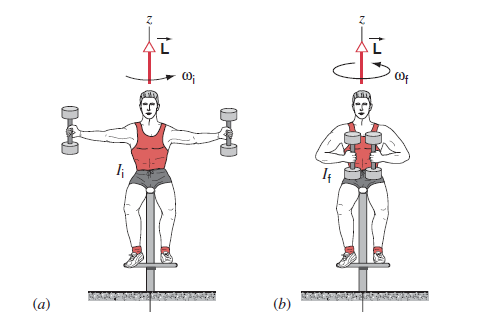

--

## Conservaci&oacute;n del momento angular

Ejemplos 

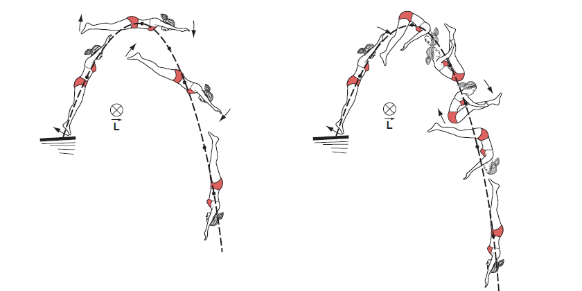

---

## Precesi&oacute;n

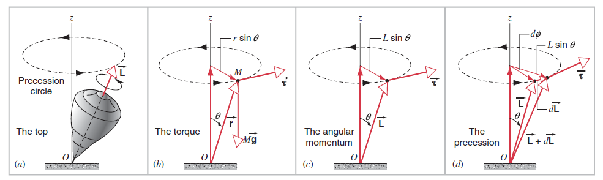

- Rotaci&oacute;n o desviaci&oacute;n de la direcci&oacute;n del eje
- Fuerzas externas (e.g. gravitacional)
- Componente perpendicular de **&tau;** respecto a **L**

