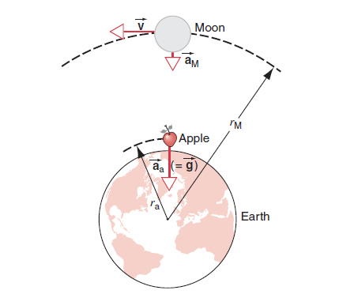
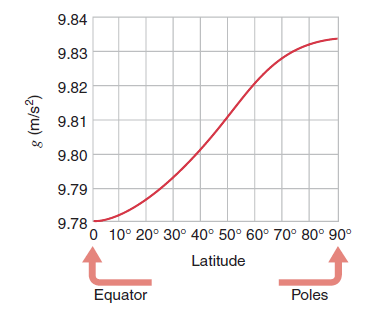
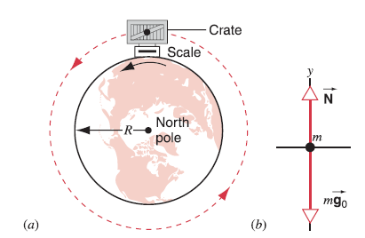
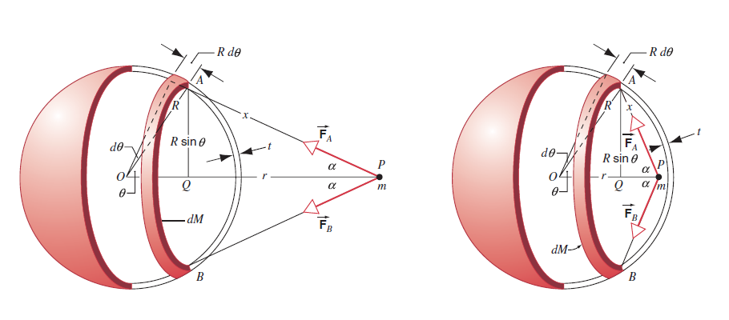
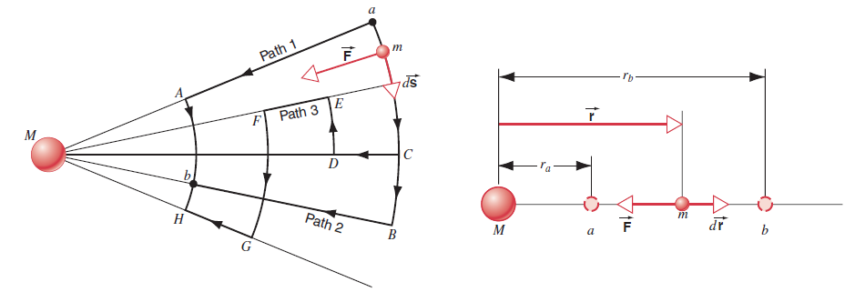
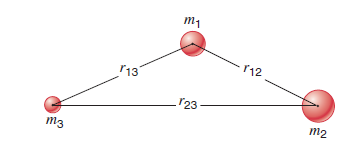
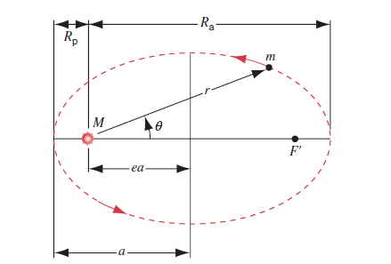
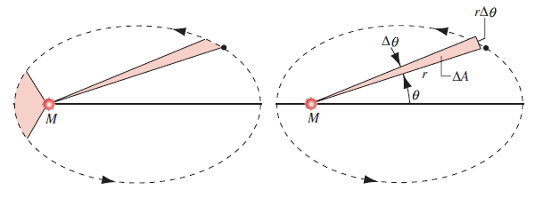

# Gravitaci&oacute;n universal

 F&iacute;sica &dash; Mec&aacute;nica

---

## Agenda

- Ley de gravitaci&oacute;n universal de Newton
- La constante gravitacional
- Gravitaci&oacute;n cerca de la superficie de un planeta
- Energ&iacute;a potencial gravitatoria
- Movimiento de planetas y sat&eacute;lites
- Campo gravitacional

---

## Ley de gravitaci&oacute;n universal de Newton

- Cada part&iacute;cula del universo atrae a todas las dem&aacute;s

---

## Fuerza gravitacional
- directamente proporcional al producto de sus masas
- inversamente proporcional al cuadrado de la distancia
- ... en la direcci&oacute; de la l&iacute;nea recta entre ellas
- Constante gravitacional
  * G = 6.67 &times; 10-11 N&middot;m-2/kg-2

<table>
  <tr>
    <td style="vertical-align:middle; padding-left:0px; padding-right:0px">**F** = -G</td>
    <td style="vertical-align: top; padding-left:0px; padding-right:0px">
      <table>
        <tr style="border-bottom: 1px solid white"><td>
m1 &middot; m2
        </td></tr>
        <tr><td style="text-align:center">
r2
        </td></tr>
      </table>
    </td>
    <td style="font-size:250%; vertical-align:middle; padding-left:0px; padding-right:0px">(</td>
    <td style="vertical-align: top; padding-left:0px; padding-right:0px">
      <table>
        <tr style="border-bottom: 1px solid white"><td>
**r**
        </td></tr>
        <tr><td style="text-align:center">
r
        </td></tr>
      </table>
    </td>
    <td style="font-size:250%; vertical-align:middle; padding-left:0px; padding-right:0px">)</td>
  </tr>
</table>

---

## Gravitaci&oacute;n cerca de la superficie

- F = m &middot; g0
  * ME : masa de la Tierra

<table>
  <tr>
    <td style="vertical-align:middle; padding-left:0px; padding-right:0px">
g0 =
    </td>
    <td style="vertical-align: top; padding-left:0px; padding-right:0px">
      <table>
        <tr style="border-bottom: 1px solid white"><td>
G &middot; ME
        </td></tr>
        <tr><td style="text-align:center">
r2
        </td></tr>
      </table>
    </td>
  </tr>
</table>

--

## Ejemplos

<table>
  <thead style="border-top: 2px solid;border-bottom: 2px solid;">
    <th>Altura (km)</th>
    <th>Lugar</th>
    <th>g0   (m/s2) </th>
  </thead>
  <tr>
    <td>0</td>
    <td>Superficie de la Tierra</td>
    <td>9.83</td>
  </tr>
  <tr>
    <td>10</td>
    <td>Altura de vuelo de crucero</td>
    <td>9.8</td>
  </tr>
  <tr>
    <td>100</td>
    <td>L&iacute;mite de la atm&oacute;sfera</td>
    <td>9.53</td>
  </tr>
  <tr>
    <td>400</td>
    <td>&Oacute;rbita de un spaces shuttle</td>
    <td>8.70</td>
  </tr>
  <tr>
    <td>35,700</td>
    <td>&Oacute;rbita de un sat&eacute;lite de comunicaci&oacute;n</td>
    <td>0.225</td>
  </tr>
  <tr>
    <td>380,000</td>
    <td>&Oacute;rbita de la Luna</td>
    <td>0.0027</td>
  </tr>
</table>

---

## Variaciones locales de la gravedad

- La corteza terrestre no es uniforme
- La Tierra no es una esfera
- La Tierra rota

---

## Bal&oacute;n o corteza uniformemente denso

- No ejerce fuerza de gravedad en su interior
- Atrae a un cuerpo externo
  * como si toda la masa estuviera en su centro

---

## Energ&iacute;a potencial gravitatoria

<table>
  <tr>
    <td style="vertical-align:middle; padding-left:0px; padding-right:0px">
U(r) = &minus;
    </td>
    <td style="vertical-align: top; padding-left:5px; padding-right:0px">
      <table>
        <tr style="border-bottom: 1px solid white"><td>
G &middot; M &middot; m 
        </td></tr>
        <tr><td style="text-align:center">
r
        </td></tr>
      </table>
    </td>
  </tr>
</table>

- Cerca de la superficie de la Tierra
  * U(h) = m&middot;g &middot;h

---

## Velocidad de escape

- Menor velocidad de salida vertical para la cual
  * un proyectil no cae de nuevo a la tierra
- Cero energ&iacute;a cin&eacute;tica y potencial para r = &infin;

<table>
  <tr>
    <td style="vertical-align:middle; padding-left:0px; padding-right:0px">
v =
    </td>
    <td style="font-size:250%;vertical-align:middle; padding-left:0px; padding-right:0px; padding-top: 0px">
&radic;
    </td>
    <td style="vertical-align: top; border-top: 2px solid; padding-left:5px; padding-right:0px, padding-top: 0px; margin-top:0.2em">
      <table>
        <tr style="border-bottom: 1px solid white">
          <td style="padding-top:0px">
2 G M
          </td>
        </tr>
        <tr><td style="text-align:center">
R
        </td></tr>
      </table>
    </td>
  </tr>
</table>

--

## Ejemplos de velocidades de escape

<table>
  <thead style="border-top: 2px solid;border-bottom: 2px solid;">
    <th>Cuerpo</th>
    <th>Masa (kg)</th>
    <th>Radio (m) </th>
    <th>Escape   (km/s) </th>
  </thead>
  <tr>
    <td>Asteroide Ceres</td>
    <td style="text-wrap: nowrap;">1.17 &times; 1021</td>
    <td>3.8 &times; 105</td>
    <td>0.64</td>
  </tr>
  <tr>
    <td>Luna</td>
    <td>7.36 &times; 1022</td>
    <td style="text-wrap: nowrap;">1.74 &times; 106</td>
    <td>2.38</td>
  </tr>
  <tr>
    <td>Tierra</td>
    <td>5.98 &times; 1024</td>
    <td>6.37 &times; 106</td>
    <td>11.2</td>
  </tr>
  <tr>
    <td>J&uacute;piter</td>
    <td>1.90 &times; 1027</td>
    <td>7.15 &times; 107</td>
    <td>59.5</td>
  </tr>
  <tr>
    <td>Sol</td>
    <td>1.99 &times; 1030</td>
    <td>6.96 &times; 108</td>
    <td>618</td>
  </tr>
  <tr>
    <td>Sirius B</td>
    <td>2 &times; 1030</td>
    <td>1 &times; 107</td>
    <td>5200</td>
  </tr>
  <tr>
    <td>Estrella de neutrones</td>
    <td>2 &times; 1030</td>
    <td>1 &times; 104</td>
    <td>2 &times; 105</td>
  </tr>
</table>

---

## Energ&iacute;a potencial

Sistema de part&iacute;culas

- Trabajo de un agente externo para ensamblar el sistema
  * Estado inicial: reposo a distancia infinita
  * Estado final: posici&oacute;n de las part&iacute;culas

<table>
  <tr>
    <td style="vertical-align:middle; padding-left:0px; padding-right:0px">
U = &minus;
    </td>
    <td style="font-size:350%; vertical-align:middle; padding-left:0px; padding-right:0px">
(
    </td>
    <td style="vertical-align: middle; padding-left:5px; padding-right:0px">
      <table>
        <tr style="border-bottom: 1px solid white"><td>
G &middot; m1 &middot; m2 
        </td></tr>
        <tr><td style="text-align:center">
r12
        </td></tr>
      </table>
    </td>
    <td style="vertical-align:middle">
+
    </td>
    <td style="vertical-align: middle; padding-left:5px; padding-right:0px">
      <table>
        <tr style="border-bottom: 1px solid white"><td>
G &middot; m2 &middot; m3 
        </td></tr>
        <tr><td style="text-align:center">
r23
        </td></tr>
      </table>
    </td>
    <td style="vertical-align:middle">
+
    </td>
    <td style="vertical-align: middle; padding-left:5px; padding-right:0px">
      <table>
        <tr style="border-bottom: 1px solid white"><td>
G &middot; m3 &middot; m1 
        </td></tr>
        <tr><td style="text-align:center">
r31
        </td></tr>
      </table>
    </td>
    <td style="font-size:350%; vertical-align:middle; padding-left:0px; padding-right:0px">
)
    </td>
  </tr>
</table>

---

## Ley de las &oacute;rbitas

Primera Ley de Kepler

- &Oacute;rbita en forma de elipse
- ... con el Sol situado en un foco

---

## Ley de las &aacute;reas

Segunda Ley de Kepler

- El segmento que une al planeta con el Sol
  * &aacute;reas iguales en intervalos de tiempo iguales

---

## Ley de los per&iacute;odos

Tercera Ley de Kepler

- Proporcionalidad per&iacute;odo vs semieje mayor

<table>
  <tr>
    <td style="vertical-align:middle; padding-left:0px; padding-right:0px">
T2 =
    </td>
    <td style="font-size:250%; vertical-align:middle; padding-left:0px; padding-right:0px">
(
    </td>
    <td style="vertical-align: top; padding-left:5px; padding-right:0px">
      <table>
        <tr style="border-bottom: 1px solid white"><td>
4 &pi;2
        </td></tr>
        <tr><td style="text-align:center">
G &middot; M
        </td></tr>
      </table>
    </td>
    <td style="font-size:250%; vertical-align:middle; padding-left:0px; padding-right:0px">
)
    </td>
    <td style="vertical-align:middle; padding-left:0px; padding-right:0px">
a3
    </td>
  </tr>
</table>

--

## Ley de los per&iacute;odos para el sistema solar

<table>
  <thead style="border-top: 2px solid;border-bottom: 2px solid;">
    <th>Planeta</th>
    <th>a (1010 m)</th>
    <th>T (a&ntilde;os) </th>
    <th>T2/a3 (&times; 10-34) </th>
  </thead>
  <tr>
    <td>Mercurio</td>
    <td>5.79</td>
    <td>0.241</td>
    <td>2.99</td>
  </tr>
  <tr>
    <td>Venus</td>
    <td>10.8</td>
    <td>0.615</td>
    <td>3.00</td>
  </tr>
  <tr>
    <td>Tierra</td>
    <td>15.0</td>
    <td>1.00</td>
    <td>2.96</td>
  </tr>
  <tr>
    <td>Marte</td>
    <td>22.8</td>
    <td>1.88</td>
    <td>2.98</td>
  </tr>
  <tr>
    <td>J&uacute;piter</td>
    <td>77.8</td>
    <td>11.9</td>
    <td>3.01</td>
  </tr>
  <tr>
    <td>Saturno</td>
    <td>143</td>
    <td>29.5</td>
    <td>2.98</td>
  </tr>
  <tr>
    <td>Urano</td>
    <td>287</td>
    <td>84.0</td>
    <td>2.98</td>
  </tr>
  <tr>
    <td>Neptuno</td>
    <td>450</td>
    <td>165</td>
    <td>2.99</td>
  </tr>
  <tr>
    <td>Plut&oacute;n</td>
    <td>590</td>
    <td>248</td>
    <td>2.99</td>
  </tr>
</table>

